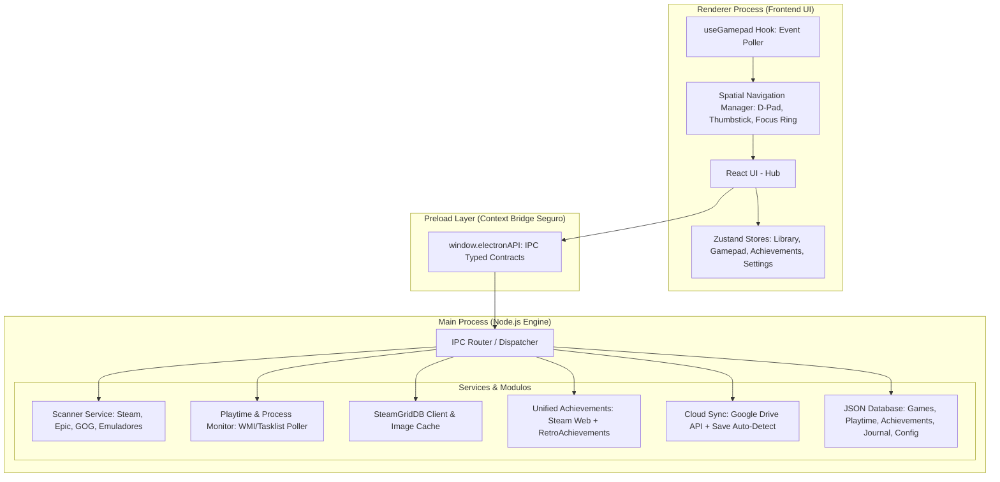

# Arquitetura do Lazulium

Hub de jogos para PC (Steam, Epic, GOG, Riot, Xbox, emuladores e jogos avulsos) com contagem de horas em qualquer jogo, diário permanente, conquistas, artes, backup de saves (no PC e no Google Drive) e navegação por controle.

---

## 1. Stack

| Camada | Tecnologia | Por quê |
| :--- | :--- | :--- |
| **Runtime Desktop** | **Electron** (com `electron-builder`) | Acesso ao Windows (processos via PowerShell/WMI, registro, arquivos) e instalador NSIS ou versão portátil. |
| **Bundler & Build** | **Vite / electron-vite** | HMR no desenvolvimento e build separado para main, preload e renderer. |
| **Frontend UI** | **React 19 + TypeScript** | Tipagem estrita do main ao renderer. |
| **Estilização** | **Tailwind CSS + Lucide Icons** | Classes utilitárias e tema escuro ajustável pelo editor de aparência. |
| **Gerenciamento de Estado** | **Zustand** | Estado da biblioteca, do controle e da casca do app sem prop drilling. |
| **Banco de Dados Local** | **JSON Store (`lazulium_db.json`)** | `userData/storage/lazulium_db.json`, com gravação atômica, cópias diárias de 14 dias e recuperação se o arquivo corromper. O cache de conquistas fica ao lado, em `lazulium_achievements.json`. Credenciais cifradas com `safeStorage`. |
| **Navegação de Controle** | **HTML5 Gamepad API + Spatial Navigation Engine** | Sem dependência extra; funciona com Xbox, PlayStation, Switch Pro e genéricos. |

---

## 2. Diagrama de Arquitetura Modular



---

## 3. Detalhamento dos Módulos Principais

### 3.1 Módulo 1: Scanner de Jogos e Emuladores (`services/scanners/`)
Responsável por identificar jogos instalados no PC e extrair executáveis, argumentos de inicialização e IDs de plataforma:
* **Steam Scanner:**
  * Localiza a instalação do Steam via Registro do Windows (`HKCU\Software\Valve\Steam`).
  * Lê e faz parse do arquivo `libraryfolders.vdf` para descobrir todas as bibliotecas configuradas (em diferentes discos).
  * Lê os manifestos `appmanifest_<appid>.acf` para listar nomes, AppIDs e pastas de instalação.
* **Epic Games Scanner:**
  * Lê manifests JSON em `C:\ProgramData\Epic\EpicGamesLauncher\Data\Manifests\*.item`.
  * Extrai `DisplayName`, `InstallLocation`, `LaunchExecutable`, `AppName`.
* **GOG Galaxy Scanner:**
  * Lê entradas no registro do Windows (`HKLM\SOFTWARE\WOW6432Node\GOG.com\Games\*`) e manifests de instalação.
* **Emuladores Scanner (`services/scanners/emulator.scanner.ts`):**
  * Suporte a perfis de emuladores populares:
    * **Dolphin** (GameCube / Wii): CLI `-b -e "<ROM_PATH>"`
    * **Ryujinx** (Switch): CLI `"<ROM_PATH>"`
    * **Cemu** (Wii U): CLI `-g "<ROM_PATH>" -f`
    * **PCSX2** (PS2): CLI `-nogui -fullscreen "<ROM_PATH>"`
    * **RPCS3** (PS3): CLI `"<EBOOT.BIN_PATH>"`
    * **DuckStation / RetroArch**
  * O usuário define pastas de ROMs para cada plataforma (ex: `F:\ROMs\Switch`, `F:\ROMs\PS2`). O scanner varre as extensões correspondentes (`.iso`, `.nsp`, `.xci`, `.wua`, etc.) e cria entradas vinculadas ao emulador correspondente.
* **Jogos Manuais & Scanner de Pastas Standalone (Jogos Soltos de PC):**
  * **Varredura em Lote por Pastas:** O usuário pode configurar diretórios raiz de jogos (ex: `F:\Games`, `D:\Jogos`). O scanner varre automaticamente cada subpasta procurando o executável ou script principal (`.exe`, `.bat`, `.cmd`), utilizando heurísticas inteligentes para priorizar scripts de inicialização (ex: `Jogar-*.bat`), executáveis com nomes expressivos e portas nativas/decompilações de PC, ignorando desinstaladores e crash handlers.
  * **Adição Individual:** Diálogo dedicado para selecionar manualmente qualquer executável `.exe` ou `.bat` com argumentos e diretório de trabalho customizados.

---

### 3.2 Módulo 2: Monitor de Processo e Rastreador de Horas (`services/tracker/`)
* **Detecção Confiável:**
  * Quando um jogo ou emulador é iniciado pelo launcher, o PID é registrado.
  * O serviço monitora o encerramento do processo (e subprocessos gerados) via polling inteligente de processos no Windows.
* **Métricas Registradas no Banco de Dados (`lazulium_db.json`):**
  * `total_playtime_seconds`: Tempo total acumulado.
  * `session_history`: Histórico de cada sessão (data/hora de início, fim, duração exata).
  * `last_played_at`: Timestamp da última vez que o jogo foi executado.
  * Proteção contra falsos positivos: tempo mínimo de execução (ex: > 15 segundos para computar sessão válida).

---

### 3.3 Módulo 3: Integração com SteamGridDB (`services/metadata/`)
* O app integra com a API oficial do **SteamGridDB** (`https://www.steamgriddb.com/api/v2`).
* Para cada jogo adicionado:
  1. Busca por nome do jogo ou ID da plataforma.
  2. Obtém:
     * **Grid (Capa vertical):** 600x900 (padrão Steam vertical).
     * **Hero (Banner horizontal):** 1920x620 (fundo cinematográfico da tela de detalhes).
     * **Logo (PNG transparente):** Logo do jogo posicionado sobre o Hero.
     * **Icon:** Ícone de alta resolução.
  3. Salva as imagens em cache local (`userData/artwork/<game_id>/<tipo>-<hash>.<ext>`; não usar `userData/cache`, que no Windows é a mesma pasta `Cache` do Chromium e pode ser limpa) para carregamento instantâneo e offline.
     O renderer as carrega pelo protocolo privilegiado `lazulium-media://media/<game_id>/<arquivo>`, que só serve arquivos de dentro do cache.
  4. Downloads são aceitos apenas via HTTPS do CDN do SteamGridDB (`*.steamgriddb.com`).
  5. Ordem de correspondência: jogo escolhido pelo usuário (`steamGridDbId`) > AppID da Steam > busca por título.

---

### 3.4 Módulo 4: Sistema Unificado de Conquistas (`services/achievements/`)
Unifica conquistas de plataformas de PC e retroemulação:
* **Steam Web API:**
  * Utiliza `GetPlayerAchievements` e `GetSchemaForGame` passando a chave de API do usuário e o SteamID64.
  * Retorna lista de conquistas, ícones (bloqueado/desbloqueado), descrição e data de desbloqueio.
* **RetroAchievements API:**
  * Conecta com a API oficial do RetroAchievements para jogos emulados (NES, SNES, GBA, PS1, PS2, Mega Drive, etc.).
  * Permite exibir conquistas retro diretamente no hub com notificações visuais na tela.

---

### 3.5 Módulo 5: Backup Automático de Saves no Google Drive (`services/cloudsync/`)
* **Localizador de Saves (`save-locator.service.ts`):**
  * Steam Cloud local (`<Steam>/userdata/<conta>/<appid>/remote`) e saves do RetroArch filtrados pelo nome da ROM têm confiança alta e são adotados automaticamente no primeiro backup.
  * Pastas com o nome do jogo (ou da pasta de instalação) em Documentos, `My Games`, `Saved Games` e `AppData` (Roaming/Local/LocalLow), direto ou abaixo da publicadora: confiança média, o usuário confirma no painel.
  * Pastas conhecidas dos emuladores (memcards do PCSX2/DuckStation, `GC`/`Wii/title` do Dolphin, `bis/user/save` do Ryujinx, etc.).
* **Arquivo (`save-archive.service.ts`):**
  * `.zip` (fflate) com `lazulium-manifest.json`: pastas de origem com tokens (`{DOCUMENTS}`, `{APPDATA}`, `{LOCALAPPDATA}`, `{USERPROFILE}`) para restaurar em outro PC/usuário, SHA-256 de cada arquivo e `contentHash` dos saves.
  * A restauração valida o hash de cada arquivo, o jogo do manifesto e bloqueia caminhos fora da pasta de destino antes de gravar.
* **Google Drive (`google-drive.service.ts`):**
  * OAuth2 para app desktop: navegador do sistema, redirecionamento loopback `127.0.0.1` e PKCE. Client ID/Secret embutidos no build pelo `.env` (`MAIN_VITE_GOOGLE_CLIENT_ID`/`SECRET`); credenciais em Configurações → Avançado têm prioridade.
  * Escopos `openid email drive.file` (só arquivos criados pelo app), pasta `Lazulium Backups/<jogo>/`, upload resumível e `appProperties` (`lazuliumGameId`, `lazuliumBackupId`, `sha256`). Sair revoga o token no Google.
  * O refresh token fica cifrado com `safeStorage` e nunca é exposto ao renderer.
* **Orquestração (`backup.service.ts`):**
  * Só com consentimento (`autoBackupConsent`, perguntado nas boas-vindas): sem ele o app não procura pastas de save, só usa as que o jogador configurou no painel do jogo.
  * Backups ficam sempre em `userData/backups/<jogo>/` e, com o Drive conectado, também na nuvem. Retenção de 10 por jogo (local e Drive) e limite de espaço local (3 GB por padrão; acima dele saem as cópias mais antigas, sempre guardando a mais nova de cada jogo).
  * Disparado ao fim de cada sessão contabilizada (via listener do tracker em `ipc/`) e numa passada diária, ignorado quando o `contentHash` não mudou.
  * Restaurar exige o jogo fechado e faz antes um backup `pre-restore` dos saves atuais. Arquivos extras na pasta de destino são mantidos.

---

### 3.5.1 Contas (`services/accounts/`)
* **Regra:** o usuário final nunca precisa colar chave de API. Chaves manuais existem só em Configurações → Avançado.
* **Steam (`steam-account.service.ts`):** lista as contas do cliente da Steam (`config/loginusers.vdf`) para conectar com um clique; "Outra conta" usa OpenID 2.0 no navegador do sistema com retorno em `127.0.0.1` e confirmação `check_authentication` na própria Steam. Sem Web API Key, as conquistas vêm do XML público `steamcommunity.com/profiles/<id>/stats/<appid>/achievements/?xml=1` + raridade global pública.
* **SteamGridDB e RetroAchievements (`web-login.service.ts`):** janela do Electron com sessão isolada (`persist:login-<serviço>`). Após o login, abre a página da chave, lê o DOM renderizado, testa as candidatas contra a API e fecha sozinha. O RetroAchievements pode pedir a verificação do Cloudflare (o usuário marca a caixa).
* **Google:** client OAuth do app embutido no build (`MAIN_VITE_GOOGLE_CLIENT_ID`/`SECRET` no `.env`, ver `.env.example`).

### 3.5.1.0 Horas fora do Lazulium
* **Jogos abertos por fora (`playtime.service.ts`, `externalCandidates`):** a cada 60 s, com `trackExternalGames` ligado, compara os programas abertos com as pastas dos jogos instalados e passa a acompanhar o que achar, com início no processo mais antigo. Ficam de fora Steam (a Steam conta e o scanner importa), emuladores (um programa, vários jogos), registros do Diário e pastas largas (que contêm a pasta de outro jogo, ou com menos de duas pastas abaixo do disco). Sem jogo acompanhado, o PowerShell da consulta é fechado depois de cada olhada.
* **Epic (`accounts/epic-account.service.ts`):** a Epic não guarda horas no PC (`eglv2/playtime/journal.json` é só fila de envio). Com o login opcional (janela do Electron, `authorizationCode` da página `/id/api/redirect`), o refresh token busca `library-service .../playtime/account/<id>/all` e grava como `sourcePlaytimeSeconds`, pela mesma regra dos scanners (`max(total atual, launcher + ajuste)`). Roda 45 s após abrir e a cada 6 h; token recusado desconecta e pede login de novo.

### 3.5.1.1 Conta Lazulium (`services/social/`, servidor em `server/social/`)
* **Opcional.** Sem token (`socialToken`, cifrado como as outras credenciais), nada é enviado e a aba Amigos só mostra o convite para entrar.
* **Login:** o app sobe um servidor em `127.0.0.1:<porta>` e abre `/v1/auth/steam/start` no navegador. Quem fala com a Steam (OpenID + `check_authentication`) é o servidor social, nunca o app; ele devolve um código de uso único preso ao `state`, trocado por um token. O token só existe no PC e, no servidor, como hash.
* **Mídia da vitrine:** imagens reduzidas e GIFs <= ~1,1 MB vão direto no D1 (`PUT /v1/me/media/:kind`). GIFs maiores e vídeos `.webm`/`.mp4` de fundo (até 50 MB) pedem bilhete HMAC-SHA-256 (`POST /v1/me/media/background/upload`) e sobem direto para a guarda em disco na VPS (`server/social/media-server.mjs`), com limpeza imediata ou via cron horário (`stored_media.purge = 1`).
* **Envio:** `social.service.ts` lê a linha do tempo (`activity.service.ts`) e manda os eventos novos (com 2 dias de sobra, porque "jogou" é agrupado por dia e cresce), mais um resumo do perfil. Roda 20 s depois de abrir, a cada 10 min e 20 s depois de mudar o Diário ou terminar uma sessão. As chaves de privacidade são aplicadas no app e de novo no servidor.
* **Jogando agora:** o listener do tracker (`ipc/events.ts`) avisa o serviço; ele manda o jogo e renova a cada 5 min, e o servidor esconde depois de 15 min sem sinal.
* **Jogo entre lojas:** `gameKey` é `steam:<appid>` ou `t:<título normalizado>` (mesma regra do `igdb-proxy`), para o mesmo jogo bater entre amigos com lojas diferentes. Capa só com endereço público: CDN da Steam pelo AppID ou `media.coverSourceUrl` (de onde a capa foi baixada).

---

### 3.5.2 Capturas e Perfil
* **Capturas (`services/metadata/screenshots.service.ts`):** lista F12 da Steam (inclusive atalhos não-Steam: gameid = `(appid do atalho << 32) | 0x02000000`, lido do `shortcuts.vdf` binário), Xbox Game Bar e imagens anexadas (`userData/screenshots/<jogo>/`). As imagens são servidas pelo protocolo `lazulium-media://` em hosts próprios (`steam-shot`, `gamebar-shot`, `shot`), cada um preso à sua raiz e a um padrão de caminho. O renderer só recebe ids opacos; o main resolve o arquivo relistando.
* **Perfil (`services/profile/profile.service.ts`):** calculado na hora a partir do banco (jogos + cache de conquistas). A exportação remove URLs `lazulium-media://`, que não existem fora deste PC.

---

### 3.5.2.1 Categorias da Biblioteca e Metadados (`services/library/categories.service.ts`, `steam-collections.service.ts`, `metadata/game-metadata.service.ts`)
* Categorias criadas pelo jogador, guardadas em `gameCategories` no banco: nome único (sem diferenciar maiúsculas e acentos), ordem do array como ordem de exibição, e dois modos — **manuais** (`gameIds`) ou **dinâmicas** (`rule`: plataforma, status, gênero, série, faixa de ano, nota mínima, favoritos e instalados, avaliadas por `@shared/utils/categories`). Um jogo pode estar em várias.
* **Importação da Steam (`steam-collections.service.ts`):** lê localmente `userdata/<conta>/config/cloudstorage/cloud-storage-namespace-1.json`, promove favoritos (`user-collections.favorite`) e cria ou mescla categorias fixas sem pedir login nem chave de API (coleções dinâmicas puras da Steam são contabilizadas como ignoradas).
* **Gêneros, ano e série (`game-metadata.service.ts`):** busca `/v1/metadata` no `igdb-proxy` em fila espaçada (~1,15 s por pedido para respeitar o limite do Worker) e sob demanda ao abrir a página do jogo; grava `genres`, `releaseYear`, `series` e `metadataCheckedAt` por jogo e avisa a janela por `LIBRARY_GAME_UPDATED`.
* Todo canal `categories:*` devolve a lista inteira (com `categories:import-steam` enviando também os jogos que viraram favoritos); o renderer guarda em `useCategoriesStore`. Apagar um jogo o tira das categorias, e um jogo que muda de id (`moveGameData`) leva as categorias e listas junto.
* Na interface: grupos da lista lateral (`LibrarySidebar`, por categoria ou por plataforma), arrastar e soltar nas categorias manuais (`utils/dragGame.ts`), filtro `category:<id>` / `uncategorized` e filtros combinados na grade (`LibraryHome`: plataforma, status, gênero, série e ano), chips clicáveis na `GamePage` e as janelas `ManageCategoriesModal` e `GameCategoriesModal`.

---

### 3.5.3 Diário de Jogos e Proteção do Banco (`src/main/database/db.ts`, `services/profile/journal.service.ts`)
* **Registro Permanente:**
  * Desinstalar um jogo **nunca** apaga seus dados. O jogo permanece no banco com `isInstalled: false`, preservando tempo total acumulado, sessões, conquistas, notas e anotações.
  * Se o jogo for reinstalado posteriormente (mesmo em outro disco ou pasta), o scanner preserva todo o histórico anterior e reassocia os registros.
* **Histórico da Steam e Nomes:**
  * Recupera o tempo histórico da Steam a partir de `localconfig.vdf` (mesmo para jogos não instalados no momento).
  * Resolve os nomes dos jogos prioritariamente pelo cache local da Steam (`appinfo.vdf`) e recorre à loja da Steam (`steam-names.service.ts`) para títulos pendentes.
* **Horas Manuais e Ajustes:**
  * Jogos fora da Steam permitem edição direta do tempo total jogado e da última sessão.
  * Para atalhos não-Steam importados da Steam, o Lazulium armazena um `playtimeAdjustmentSeconds` somado ao tempo reportado pela Steam (`sourcePlaytimeSeconds`). Ao sincronizar a biblioteca, o valor resultante é `max(atual, fonte + ajuste)`, sobrevivendo aos novos scans da Steam.
* **Integridade e Proteção contra Falhas:**
  * **Gravação Atômica:** Toda persistência escreve primeiro em um arquivo temporário (`lazulium_db.json.tmp`) e executa uma substituição atômica (`renameSync`). Quedas de energia ou travamentos do sistema no meio da gravação nunca corrompem o banco principal.
  * **Backups Diários Automáticos:** Antes da primeira alteração de cada dia, uma cópia completa é salva em `userData/storage/backups/lazulium_db-YYYY-MM-DD.json`, mantendo automaticamente os últimos 14 dias de histórico.
  * **Recuperação Automática de Corrupção (`loadWithRecovery`):** Se o arquivo JSON for danificado ou inválido, ele é renomeado para `lazulium_db.json.corrupt-<timestamp>` e o Lazulium restaura automaticamente a cópia de segurança diária válida mais recente.
  * **Cifragem de Credenciais:** Tokens sensíveis (chaves de API, segredos OAuth) são cifrados pelo `safeStorage` do Electron no disco (prefixo `enc:`) e decifrados apenas em memória. Usa a API assíncrona (`encryptStringAsync` / `decryptStringAsync`; a síncrona sai no Electron 46): ao mudar uma credencial, o texto cifrado é preparado em segundo plano e a gravação seguinte já o leva. Gravação no meio desse intervalo mantém o que estava no arquivo, nunca texto puro.
  * **Conquistas em Arquivo Próprio:** `gameAchievements` (o cache das listas, mais de 90% do peso do banco) é gravado em `userData/storage/lazulium_achievements.json`, com gravação atômica e sem cópia diária, porque volta numa sincronização. Sincronizar conquistas não regrava a biblioteca, e mexer na biblioteca não regrava as conquistas. Banco de antes da 2.5 (ou cópia diária antiga restaurada) é convertido ao abrir: o arquivo próprio é gravado primeiro e só depois o principal fica sem o campo. O que o jogador registrou por conta própria (`achievementExtras`) continua no banco principal, coberto pelas cópias diárias.

---

### 3.6 Módulo 6: Navegação por Controle (Gamepad Spatial Navigation)
* **Compatibilidade:** Controles Xbox (XInput), PlayStation 4/5 (DirectInput / DualSense), Nintendo Switch Pro Controller e teclado.
* **Navegação Espacial (2D Grid):**
  * Cálculo geométrico de elemento focável mais próximo na direção solicitada (Cima, Baixo, Esquerda, Direita).
  * `A` / `Cross`: Executar ação / Abrir detalhes / Iniciar jogo.
  * `B` / `Circle`: Voltar / Fechar modal.
  * `X` / `Square`: Favoritar / Ações rápidas.
  * `Y` / `Triangle`: Busca rápida.
  * `LB` / `RB` (ou `L1` / `R1`): Alternar abas / filtros (Todos, Steam, Epic, Emuladores, Favoritos).
* **Interface única:** o mesmo layout atende mouse/teclado e controle (não há modo Big Picture separado).

---

## 4. Contratos de IPC (Inter-Process Communication)

Os canais (cerca de 110) ficam em `src/shared/constants/ipc-channels.ts`, no formato `dominio:acao`; os tipos de pedido e resposta e a interface `IpcApi` em `src/shared/types/ipc.ts`; a ponte em `src/preload/index.ts` (`window.electronAPI`).

```typescript
// Trecho de src/shared/constants/ipc-channels.ts
export const IPC_CHANNELS = {
  LIBRARY_SCAN_ALL: 'library:scan-all',
  LIBRARY_GET_GAMES: 'library:get-games',
  EMULATORS_EXPORT_PRESETS: 'emulators:export-presets',
  GAME_LAUNCH: 'game:launch',
  GAME_STATUS_CHANGED: 'game:status-changed',   // evento main -> renderer
  // ...
} as const;
```

No main, os handlers ficam divididos por domínio em `src/main/ipc/` (`library`, `play`, `emulators`, `achievements`, `artwork`, `backup`, `accounts`, `profile`, `journal`, `screenshots`, `wishlist`, `system`), registrados por `ipc/index.ts`:
* `ipc/helpers.ts`: `handle()` registra o canal e converte erros do sistema (arquivo preso, disco cheio, sem rede) em mensagens em português para o jogador.
* `ipc/events.ts`: eventos main -> renderer; sem janela aberta (app na bandeja) o evento é descartado e a interface relê tudo ao abrir.

Passo a passo para um canal novo: ver a seção 5 do `CLAUDE.md`.

---

## 5. Estrutura do Banco de Dados Local (JSON - `lazulium_db.json`)

O banco de dados do Lazulium fica em `userData/storage/lazulium_db.json` (mais o cache de conquistas em `lazulium_achievements.json`, que na memória continua sendo o campo `gameAchievements`), gerenciado centralmente por `src/main/database/db.ts`:
* `database/storage.ts`: o arquivo no disco (leitura com novas tentativas quando antivírus ou indexador seguram o arquivo, gravação atômica e cópias diárias). Não conhece o formato dos dados.
* `database/normalize.ts`: `SCHEMA_VERSION` e `normalizeData`, que converte bancos de versões anteriores ao abrir. Mudou o formato de um dado guardado? Suba a versão e converta ali.

A tipagem completa do schema principal segue a interface `DatabaseSchema`:

```typescript
export interface DatabaseSchema {
  schemaVersion?: number;           // ausente = anterior à 1.0
  games: Game[];
  playtimeSessions: PlaytimeSession[];
  achievements: Achievement[];      // legado: as conquistas ficam em gameAchievements
  gameAchievements?: Record<string, GameAchievements>;
  achievementExtras?: Record<string, AchievementExtras>;
  emulatorConfigs: EmulatorConfig[];
  standaloneDirectories: string[];
  activeSessions: ActiveSessionRecord[];
  saveConfigs?: Record<string, GameSaveConfig>;
  saveBackups?: BackupRecord[];
  profileCustom?: ProfileCustom;
  steamProfileCache?: SteamProfileIdentity;
  playLengthCache?: Record<string, CachedPlayLength>;
  gameLists?: GameList[];
  wishlist?: WishlistItem[];
  screenshotMoves?: ScreenshotMove[];
  profileWeb?: { repoUrl: string; lastPublishedAt?: string };
  settings: Record<string, string>;
}
```

### 5.1 Principais Modelos de Dados

- **`Game` (`src/shared/types/game.ts`):**
  - **Identificação:** `id`, `title`, `platform` (`'steam' | 'epic' | 'gog' | 'emulator' | 'standalone' | 'riot' | 'xbox'`), `platformGameId`.
  - **Execução:** `executablePath`, `launchArguments`, `workingDirectory`, `emulatorId`, `romPath`, `opensViaLauncher`.
  - **Instalação e Estado:** `isInstalled` (preserva histórico de jogos desinstalados), `isFavorite`, `isHidden`, `tags`.
  - **Metadados Visuais:** `coverUrl`, `heroUrl`, `logoUrl`, `iconUrl`, `steamGridDbId`.
  - **Estatísticas de Tempo:** `totalPlaytimeSeconds`, `sourcePlaytimeSeconds`, `playtimeAdjustmentSeconds` (ajuste sobre fonte externa), `lastPlayedAt`.
  - **Diário de Jogos:** `userStatus` (`'playing' | 'completed' | 'mastered' | 'paused' | 'abandoned' | 'backlog'`), `userRating` (1 a 10), `userNotes`, `startedAt`, `completedAt`, `isManualEntry`.

- **`PlaytimeSession` (`src/shared/types/game.ts`):**
  - Histórico de sessões individuais: `id`, `gameId`, `startedAt`, `endedAt`, `durationSeconds`.

- **`ActiveSessionRecord` (`src/main/database/db.ts`):**
  - Heartbeat periódico para monitoramento em tempo real: `gameId`, `startedAt`, `lastSeenAt`, `idleSeconds`. Permite recuperação automática de sessões não finalizadas após queda do app ou do sistema.

- **`Achievement` & `GameAchievements` (`src/shared/types/achievements.ts`):**
  - Cache de conquistas por jogo: `id`, `gameId`, `apiName`, `title`, `description`, `iconUrl`, `iconGrayUrl`, `isUnlocked`, `unlockedAt`, `source` (`'steam' | 'retroachievements'`), além de métricas agregadas (`unlockedCount`, `totalCount`, `percentage`).

- **`GameSaveConfig` & `BackupRecord` (`src/shared/types/cloudsync.ts`):**
  - Configuração de localização de saves detectados/confirmados e histórico de versões compactadas (local e Google Drive) com hashes SHA-256 de integridade.

- **`Settings`:**
  - Chave-valor para configurações da aplicação. Credenciais e tokens sensíveis são cifrados no disco com prefixo `enc:` usando `safeStorage` do Electron. Segredos que este PC não consegue decifrar voltam ao arquivo intactos (não são apagados).

---

## 6. Serviços externos

Toda conexão de rede sai do processo main; o renderer só carrega imagens (CSP em `src/main/index.ts` e `src/renderer/index.html`). Os pedidos passam por `services/metadata/http.ts` (tempo limite, nova tentativa em 429/5xx respeitando `Retry-After`, erros em português que nunca trazem a URL). O que cada serviço recebe está descrito para o jogador em [`docs/privacidade.md`](docs/privacidade.md); atualize-a ao acrescentar um serviço ou um dado enviado.

| Serviço | Usado por | Credencial |
|---|---|---|
| Steam (`steamcommunity.com`, `api.steampowered.com`, `store.steampowered.com`) | conquistas (XML público), perfil, desejos, nomes, preços, análises, OpenID | nenhuma (Web API Key opcional em Avançado) |
| SteamGridDB (opcional) | escolher artes, logos e ícones | chave do jogador, capturada pela janela de login |
| RetroAchievements | conquistas de emulador | usuário + chave do jogador |
| Servidor próprio `server/igdb-proxy` (Cloudflare Worker, `IGDB_PROXY_URL` em `play-length.service.ts`) | gênero, ano e série (`/v1/metadata`, IGDB), tempo para zerar, busca e capas sem conta (`/v1/artwork`, IGDB), preços de outras lojas (`/v1/prices`, GG.deals) | segredos só no Worker (`TWITCH_CLIENT_ID/SECRET`, `GGDEALS_API_KEY`) |
| Google (OAuth + Drive v3) | backup de saves | client OAuth do build (`.env`) + refresh token cifrado |
| GitHub (via `git` do sistema) | Perfil → Publicar na web | login do Git do jogador |
| GitHub Releases (`electron-updater`; `latest.yml` na portátil) | atualização automática | nenhuma |
| Epic Games (`account-public-service-prod03`, `library-service`) | horas dos jogos da Epic (`epic-account.service.ts`, opcional) | refresh token da conta do jogador (cliente público do launcher, como o Legendary), cifrado |
| Servidor próprio `server/social` (Cloudflare Worker + D1 e `media-server.mjs` na VPS, `SOCIAL_SERVER_URL` em `social.service.ts`) | conta Lazulium: amigos, jogando agora, feed, vitrine e arquivos grandes de fundo até 50 MB | token de sessão do jogador + `MEDIA_SECRET` compartilhado entre Worker e VPS |

Não há telemetria nem envio automático de erros: o `lazulium.log` (`userData/logs`, rotação em 2 MB) só sai do PC pelas mãos do jogador.

---

## 7. Build, bundle e empacotamento

### 7.1 Bundle (`electron.vite.config.ts`)
* **Main e preload:** CommonJS, sem minificação (nomes legíveis nos erros do log). As dependências de `dependencies` ficam fora do bundle (`externalizeDeps`, padrão do electron-vite 6) e são lidas do `node_modules` empacotado. Hoje o main só carrega `fflate` assim.
* **Renderer:** minificado (esbuild, JS e CSS), sem sourcemaps, com `manualChunks` separando `react` (react, react-dom, scheduler) e `icons` (lucide-react); páginas carregadas com `React.lazy` viram arquivos próprios. Na 1.0: 1,25 MB de JS num arquivo só → ~0,58 MB em três.
* O bloco `build` do renderer não afeta o `npm run dev` (servidor do Vite com HMR).
* Build de teste fora de `out/`: use caminho **absoluto** em `--outDir` (`npx electron-vite build --outDir F:/.../out-agents/x`). Com caminho relativo, o renderer vai parar dentro de `src/renderer/`, porque a raiz dele é `src/renderer`.

### 7.2 Empacotamento (`package.json` → `build`, electron-builder 25)
* **Alvos:** `nsis` (instalador por usuário, sem administrador, com escolha de pasta) e `portable`, ambos x64. Nomes: `Lazulium-Setup-<versão>.exe` e `Lazulium-Portable-<versão>.exe`.
* **Instalador:** em português (`installerLanguages: pt_BR`, `language: 1046`), ícone do app, barra lateral e cabeçalho gerados da logo (`resources/installerSidebar.bmp`, `installerHeader.bmp`, por `npm run icons`), atalhos na Área de Trabalho e no Menu Iniciar, opção de abrir o app no fim. O `appId` (`com.lazulium.app`) define o GUID da instalação: **não mude**, ou a versão nova não substitui a antiga.
* **Dados do usuário:** `deleteAppDataOnUninstall: false`; desinstalar mantém `%APPDATA%\Lazulium`.
* **Conteúdo do `app.asar`:** `out/**` e `package.json`, sem `*.map`, e **sem** as bibliotecas do renderer (`react`, `react-dom`, `scheduler`, `lucide-react`, `zustand`, `clsx`, `tailwind-merge`), que já vão dentro do bundle do Vite: 35,7 MB → ~2 MB. Se o main passar a usar uma delas, tire-a da lista de exclusões em `build.files`.
* **Idiomas do Chromium:** só `pt-BR` e `en-US` (`electronLanguages`), ~40 MB a menos instalado. Datas e números usam `pt-BR` explícito e não dependem disso.
* **`extraResources`** (lidos em produção por `process.resourcesPath`): `icon.ico`, `icon.png`, `tray.ico` (janela, bandeja, notificações; `app-shell.ts`) e `web-profile/index.html` (modelo da página do perfil; `profile-web.service.ts`).
* **Conferência:** `scripts/check-package.mjs` roda em `build:win` e `build:portable` antes do electron-builder e para o build se o main/preload usar um módulo fora de `dependencies` ou excluído do pacote, ou se faltar um arquivo de `extraResources` ou imagem do instalador.
* Publicação, assinatura e atualização automática: [`docs/publicar-1.0.md`](docs/publicar-1.0.md).
