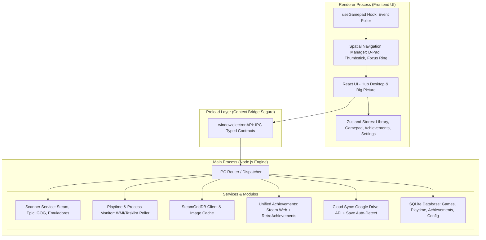

# 🏛️ SteamGridForge (Steam 2) - Arquitetura de Software

> **Codinome:** Steam 2  
> **Nome do Projeto:** SteamGridForge  
> **Propósito:** Hub Universal de Jogos para PC (Steam, Epic, GOG, Emuladores e Standalones) com rastreador de horas universal, conquistas unificadas, artes via SteamGridDB, backup em nuvem de saves e suporte total a controles (Big Picture / 10-foot UI).

---

## 1. Visão Geral e Pilares Tecnológicos

### 1.1 Stack Recomendada: Electron + Vite + React 19 + TypeScript + Tailwind CSS

| Camada | Tecnologia | Motivação |
| :--- | :--- | :--- |
| **Runtime Desktop** | **Electron** (com `electron-builder`) | Acesso direto a APIs do Windows (WMI, processo via `child_process`/PowerShell, registro do Windows, FileSystem) e geração de instalador `.exe` (NSIS) ou versão Portable com 1 clique. |
| **Bundler & Build** | **Vite / electron-vite** | Hot Module Replacement (HMR) ultrarrápido, compilação TypeScript instantânea e empacotamento otimizado. |
| **Frontend UI** | **React 19 + TypeScript** | Ecossistema maduro, componentes declarativos, tipagem estrita de ponta a ponta. |
| **Estilização** | **Tailwind CSS + Lucide Icons** | Design moderno no estilo "Steam Deck / Big Picture / Xbox Dashboard", animações fluidas e suporte a temas escuros profundos (OLED dark). |
| **Gerenciamento de Estado** | **Zustand** | Leve, desacoplado, sem boilerplate desnecessário, ideal para gerenciar estado da biblioteca, foco de controle e download de artes. |
| **Banco de Dados Local** | **SQLite (`better-sqlite3` ou `sqlite3`)** | Armazenamento local rápido e confiável para catálogo de jogos, histórico de sessões de jogatina, conquistas em cache e metadados. |
| **Navegação de Controle** | **HTML5 Gamepad API + Spatial Navigation Engine** | Suporte nativo e sem dependências extras para controles Xbox, PlayStation (DualShock/DualSense), Switch Pro e genéricos DirectInput/XInput. |

---

## 2. Diagrama de Arquitetura Modular



---

## 3. Detalhamento dos Módulos Principais

### 3.1 Módulo 1: Scanner de Jogos e Emuladores (`services/scanners/`)
Responsável por identificar jogos instalados no PC e extrair executáveis, argumentos de inicialização e IDs de plataforma:
* **Steam Scanner:**
  * Localiza a instalação do Steam via Registro do Windows (`HKCU\Software\Valve\Steam`).
  * Lê e faz parse do arquivo `libraryfolders.vdf` para descobrir todas as bibliotecas configuradas (em diferentes discos).
  * Lê os manifestos `appmanifest_<appid>.acf` para listar nomes, AppIDs e pastas de instalação.
* **Epic Games Scanner:**
  * Lê manifests JSON em `C:\ProgramData\Epic\EpicGamesLauncher\Data\Manifests\*.item`.
  * Extrai `DisplayName`, `InstallLocation`, `LaunchExecutable`, `AppName`.
* **GOG Galaxy Scanner:**
  * Lê entradas no registro do Windows (`HKLM\SOFTWARE\WOW6432Node\GOG.com\Games\*`) e manifests de instalação.
* **Emuladores Scanner (`services/scanners/emulator.scanner.ts`):**
  * Suporte a perfis de emuladores populares:
    * **Dolphin** (GameCube / Wii): CLI `-b -e "<ROM_PATH>"`
    * **Ryujinx** (Switch): CLI `"<ROM_PATH>"`
    * **Cemu** (Wii U): CLI `-g "<ROM_PATH>" -f`
    * **PCSX2** (PS2): CLI `-nogui -fullscreen "<ROM_PATH>"`
    * **RPCS3** (PS3): CLI `"<EBOOT.BIN_PATH>"`
    * **DuckStation / RetroArch**
  * O usuário define pastas de ROMs para cada plataforma (ex: `F:\ROMs\Switch`, `F:\ROMs\PS2`). O scanner varre as extensões correspondentes (`.iso`, `.nsp`, `.xci`, `.wua`, etc.) e cria entradas vinculadas ao emulador correspondente.
* **Jogos Manuais / Standalone:**
  * Permite adicionar qualquer executável `.exe` com argumentos customizados e diretório de trabalho.

---

### 3.2 Módulo 2: Monitor de Processo e Rastreador de Horas (`services/tracker/`)
* **Detecção Confiável:**
  * Quando um jogo ou emulador é iniciado pelo launcher, o PID é registrado.
  * O serviço monitora o encerramento do processo (e subprocessos gerados) via polling inteligente de processos no Windows.
* **Métricas Registradas no SQLite:**
  * `total_playtime_seconds`: Tempo total acumulado.
  * `session_history`: Histórico de cada sessão (data/hora de início, fim, duração exata).
  * `last_played_at`: Timestamp da última vez que o jogo foi executado.
  * Proteção contra falsos positivos: tempo mínimo de execução (ex: > 15 segundos para computar sessão válida).

---

### 3.3 Módulo 3: Integração com SteamGridDB (`services/metadata/`)
* O app integra com a API oficial do **SteamGridDB** (`https://www.steamgriddb.com/api/v2`).
* Para cada jogo adicionado:
  1. Busca por nome do jogo ou ID da plataforma.
  2. Obtém:
     * **Grid (Capa vertical):** 600x900 (padrão Steam vertical).
     * **Hero (Banner horizontal):** 1920x620 (fundo cinematográfico da tela de detalhes).
     * **Logo (PNG transparente):** Logo do jogo posicionado sobre o Hero.
     * **Icon:** Ícone de alta resolução.
  3. Salva as imagens em cache local (`assets/cache/covers/<game_id>/`) para carregamento instantâneo e offline.

---

### 3.4 Módulo 4: Sistema Unificado de Conquistas (`services/achievements/`)
Unifica conquistas de plataformas de PC e retroemulação:
* **Steam Web API:**
  * Utiliza `GetPlayerAchievements` e `GetSchemaForGame` passando a chave de API do usuário e o SteamID64.
  * Retorna lista de conquistas, ícones (bloqueado/desbloqueado), descrição e data de desbloqueio.
* **RetroAchievements API:**
  * Conecta com a API oficial do RetroAchievements para jogos emulados (NES, SNES, GBA, PS1, PS2, Mega Drive, etc.).
  * Permite exibir conquistas retro diretamente no hub com notificações visuais na tela.

---

### 3.5 Módulo 5: Backup Automático de Saves no Google Drive (`services/cloudsync/`)
* **Localizador de Saves:**
  * Mapeamento de diretórios comuns de saves (`%USERPROFILE%\Saved Games`, `%APPDATA%`, `%LOCALAPPDATA%`, pastas de emuladores como `User/nand` ou `memcards`).
* **Sincronização:**
  * Autenticação OAuth2 simples via Google Drive API.
  * Pasta dedicada no Google Drive do usuário: `SteamGridForge_CloudSaves/`.
  * Criação de arquivo `.zip` com timestamp e hash MD5 para evitar uploads duplicados.
  * Backup disparado automaticamente assim que o jogo é fechado (com notificação de conclusão).

---

### 3.6 Módulo 6: Navegação por Controle (Gamepad Spatial Navigation)
* **Compatibilidade:** Controles Xbox (XInput), PlayStation 4/5 (DirectInput / DualSense), Nintendo Switch Pro Controller e teclado.
* **Navegação Espacial (2D Grid):**
  * Cálculo geométrico de elemento focável mais próximo na direção solicitada (Cima, Baixo, Esquerda, Direita).
  * `A` / `Cross`: Executar ação / Abrir detalhes / Iniciar jogo.
  * `B` / `Circle`: Voltar / Fechar modal.
  * `X` / `Square`: Favoritar / Ações rápidas.
  * `Y` / `Triangle`: Busca rápida.
  * `LB` / `RB` (ou `L1` / `R1`): Alternar abas / filtros (Todos, Steam, Epic, Emuladores, Favoritos).
* **Dois Modos de Interface:**
  1. **Desktop Mode:** Layout otimizado para mouse/teclado com tabelas, filtros laterais e densidade ajustável.
  2. **Big Picture / Handheld Mode:** Interface cinematográfica estilo console / Steam Deck para TVs e monitores à distância.

---

## 4. Contratos de IPC (Inter-Process Communication)

Todos os canais de IPC seguem o padrão tipado `IPC_CHANNELS`:

```typescript
// Exemplos de Canais IPC
export const IPC_CHANNELS = {
  // Biblioteca & Scanner
  LIBRARY_SCAN: 'library:scan',
  LIBRARY_GET_GAMES: 'library:get-games',
  LIBRARY_ADD_CUSTOM_GAME: 'library:add-custom-game',
  LIBRARY_UPDATE_GAME: 'library:update-game',
  LIBRARY_DELETE_GAME: 'library:delete-game',
  
  // Execução & Playtime
  GAME_LAUNCH: 'game:launch',
  GAME_STATUS_CHANGED: 'game:status-changed',
  GAME_GET_PLAYTIME_HISTORY: 'game:get-playtime-history',
  
  // Metadados & SteamGridDB
  METADATA_FETCH_ASSETS: 'metadata:fetch-assets',
  METADATA_APPLY_ASSET: 'metadata:apply-asset',
  
  // Conquistas
  ACHIEVEMENTS_GET: 'achievements:get',
  ACHIEVEMENTS_REFRESH: 'achievements:refresh',
  
  // Nuvem / Saves
  CLOUDSYNC_BACKUP: 'cloudsync:backup',
  CLOUDSYNC_RESTORE: 'cloudsync:restore',
  CLOUDSYNC_GET_STATUS: 'cloudsync:get-status',
  
  // Sistema / Janela
  WINDOW_MINIMIZE: 'window:minimize',
  WINDOW_MAXIMIZE: 'window:maximize',
  WINDOW_CLOSE: 'window:close'
} as const;
```

---

## 5. Esquema do Banco de Dados SQLite (`schema.sql`)

```sql
CREATE TABLE IF NOT EXISTS games (
    id TEXT PRIMARY KEY,
    title TEXT NOT NULL,
    platform TEXT NOT NULL, -- 'steam', 'epic', 'gog', 'emulator', 'standalone'
    platform_game_id TEXT,  -- Steam AppID, Epic AppName, etc.
    executable_path TEXT NOT NULL,
    launch_arguments TEXT,
    working_directory TEXT,
    emulator_id TEXT,       -- Ex: 'dolphin', 'ryujinx' (se platform == 'emulator')
    rom_path TEXT,
    
    -- Metadados visuais
    cover_url TEXT,
    hero_url TEXT,
    logo_url TEXT,
    icon_url TEXT,
    is_favorite INTEGER DEFAULT 0,
    is_hidden INTEGER DEFAULT 0,
    tags TEXT,              -- JSON array: ["RPG", "Zelda", "Nintendo"]
    
    -- Estatísticas
    total_playtime_seconds INTEGER DEFAULT 0,
    last_played_at DATETIME,
    created_at DATETIME DEFAULT CURRENT_TIMESTAMP,
    updated_at DATETIME DEFAULT CURRENT_TIMESTAMP
);

CREATE TABLE IF NOT EXISTS playtime_sessions (
    id TEXT PRIMARY KEY,
    game_id TEXT NOT NULL,
    started_at DATETIME NOT NULL,
    ended_at DATETIME NOT NULL,
    duration_seconds INTEGER NOT NULL,
    FOREIGN KEY(game_id) REFERENCES games(id) ON DELETE CASCADE
);

CREATE TABLE IF NOT EXISTS achievements (
    id TEXT PRIMARY KEY,
    game_id TEXT NOT NULL,
    api_name TEXT NOT NULL,
    title TEXT NOT NULL,
    description TEXT,
    icon_url TEXT,
    icon_gray_url TEXT,
    is_unlocked INTEGER DEFAULT 0,
    unlocked_at DATETIME,
    source TEXT NOT NULL,   -- 'steam', 'retroachievements'
    FOREIGN KEY(game_id) REFERENCES games(id) ON DELETE CASCADE
);

CREATE TABLE IF NOT EXISTS settings (
    key TEXT PRIMARY KEY,
    value TEXT NOT NULL
);
```
