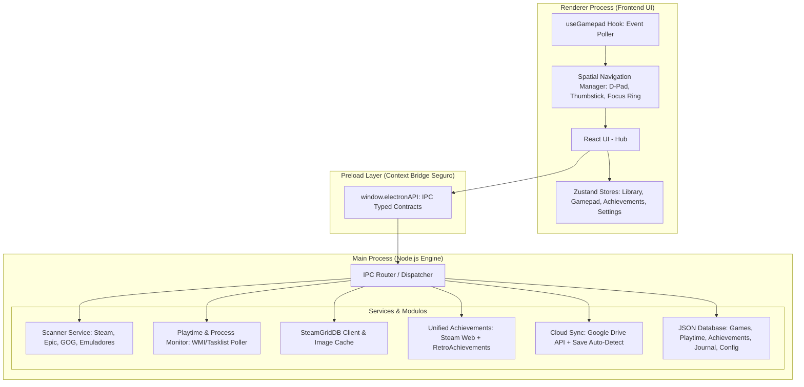

# 🏛️ Lazulium (Steam 2) - Arquitetura de Software

> **Codinome:** Steam 2  
> **Nome Provisório/Principal:** Lazulium  
> **Propósito:** Hub Universal de Jogos para PC (Steam, Epic, GOG, Emuladores e Standalones) com rastreador de horas universal, conquistas unificadas, artes via SteamGridDB, backup em nuvem de saves e suporte total a controles.

---

## 1. Visão Geral e Pilares Tecnológicos

### 1.1 Stack Recomendada: Electron + Vite + React 19 + TypeScript + Tailwind CSS

| Camada | Tecnologia | Motivação |
| :--- | :--- | :--- |
| **Runtime Desktop** | **Electron** (com `electron-builder`) | Acesso direto a APIs do Windows (WMI, processo via `child_process`/PowerShell, registro do Windows, FileSystem) e geração de instalador `.exe` (NSIS) ou versão Portable com 1 clique. |
| **Bundler & Build** | **Vite / electron-vite** | Hot Module Replacement (HMR) ultrarrápido, compilação TypeScript instantânea e empacotamento otimizado. |
| **Frontend UI** | **React 19 + TypeScript** | Ecossistema maduro, componentes declarativos, tipagem estrita de ponta a ponta. |
| **Estilização** | **Tailwind CSS + Lucide Icons** | Design moderno no estilo "Steam Deck / Xbox Dashboard", animações fluidas e suporte a temas escuros profundos (OLED dark). |
| **Gerenciamento de Estado** | **Zustand** | Leve, desacoplado, sem boilerplate desnecessário, ideal para gerenciar estado da biblioteca, foco de controle e download de artes. |
| **Banco de Dados Local** | **JSON Store (`lazulium_db.json`)** | Armazenamento local em arquivo JSON estruturado em `userData/storage/lazulium_db.json`, com gravação atômica, histórico de 14 dias de backups e recuperação automática de corrupção. Credenciais cifradas via `safeStorage`. |
| **Navegação de Controle** | **HTML5 Gamepad API + Spatial Navigation Engine** | Suporte nativo e sem dependências extras para controles Xbox, PlayStation (DualShock/DualSense), Switch Pro e genéricos DirectInput/XInput. |

---

## 2. Diagrama de Arquitetura Modular



---

## 3. Detalhamento dos Módulos Principais

### 3.1 Módulo 1: Scanner de Jogos e Emuladores (`services/scanners/`)
Responsável por identificar jogos instalados no PC e extrair executáveis, argumentos de inicialização e IDs de plataforma:
* **Steam Scanner:**
  * Localiza a instalação do Steam via Registro do Windows (`HKCU\Software\Valve\Steam`).
  * Lê e faz parse do arquivo `libraryfolders.vdf` para descobrir todas as bibliotecas configuradas (em diferentes discos).
  * Lê os manifestos `appmanifest_<appid>.acf` para listar nomes, AppIDs e pastas de instalação.
* **Epic Games Scanner:**
  * Lê manifests JSON em `C:\ProgramData\Epic\EpicGamesLauncher\Data\Manifests\*.item`.
  * Extrai `DisplayName`, `InstallLocation`, `LaunchExecutable`, `AppName`.
* **GOG Galaxy Scanner:**
  * Lê entradas no registro do Windows (`HKLM\SOFTWARE\WOW6432Node\GOG.com\Games\*`) e manifests de instalação.
* **Emuladores Scanner (`services/scanners/emulator.scanner.ts`):**
  * Suporte a perfis de emuladores populares:
    * **Dolphin** (GameCube / Wii): CLI `-b -e "<ROM_PATH>"`
    * **Ryujinx** (Switch): CLI `"<ROM_PATH>"`
    * **Cemu** (Wii U): CLI `-g "<ROM_PATH>" -f`
    * **PCSX2** (PS2): CLI `-nogui -fullscreen "<ROM_PATH>"`
    * **RPCS3** (PS3): CLI `"<EBOOT.BIN_PATH>"`
    * **DuckStation / RetroArch**
  * O usuário define pastas de ROMs para cada plataforma (ex: `F:\ROMs\Switch`, `F:\ROMs\PS2`). O scanner varre as extensões correspondentes (`.iso`, `.nsp`, `.xci`, `.wua`, etc.) e cria entradas vinculadas ao emulador correspondente.
* **Jogos Manuais & Scanner de Pastas Standalone (Jogos Soltos de PC):**
  * **Varredura em Lote por Pastas:** O usuário pode configurar diretórios raiz de jogos (ex: `F:\Games`, `D:\Jogos`). O scanner varre automaticamente cada subpasta procurando o executável ou script principal (`.exe`, `.bat`, `.cmd`), utilizando heurísticas inteligentes para priorizar scripts de inicialização (ex: `Jogar-*.bat`), executáveis com nomes expressivos e portas nativas/decompilações de PC, ignorando desinstaladores e crash handlers.
  * **Adição Individual:** Diálogo dedicado para selecionar manualmente qualquer executável `.exe` ou `.bat` com argumentos e diretório de trabalho customizados.

---

### 3.2 Módulo 2: Monitor de Processo e Rastreador de Horas (`services/tracker/`)
* **Detecção Confiável:**
  * Quando um jogo ou emulador é iniciado pelo launcher, o PID é registrado.
  * O serviço monitora o encerramento do processo (e subprocessos gerados) via polling inteligente de processos no Windows.
* **Métricas Registradas no Banco de Dados (`lazulium_db.json`):**
  * `total_playtime_seconds`: Tempo total acumulado.
  * `session_history`: Histórico de cada sessão (data/hora de início, fim, duração exata).
  * `last_played_at`: Timestamp da última vez que o jogo foi executado.
  * Proteção contra falsos positivos: tempo mínimo de execução (ex: > 15 segundos para computar sessão válida).

---

### 3.3 Módulo 3: Integração com SteamGridDB (`services/metadata/`)
* O app integra com a API oficial do **SteamGridDB** (`https://www.steamgriddb.com/api/v2`).
* Para cada jogo adicionado:
  1. Busca por nome do jogo ou ID da plataforma.
  2. Obtém:
     * **Grid (Capa vertical):** 600x900 (padrão Steam vertical).
     * **Hero (Banner horizontal):** 1920x620 (fundo cinematográfico da tela de detalhes).
     * **Logo (PNG transparente):** Logo do jogo posicionado sobre o Hero.
     * **Icon:** Ícone de alta resolução.
  3. Salva as imagens em cache local (`userData/cache/media/<game_id>/<tipo>-<hash>.<ext>`) para carregamento instantâneo e offline.
     O renderer as carrega pelo protocolo privilegiado `lazulium-media://media/<game_id>/<arquivo>`, que só serve arquivos de dentro do cache.
  4. Downloads são aceitos apenas via HTTPS do CDN do SteamGridDB (`*.steamgriddb.com`).
  5. Ordem de correspondência: jogo escolhido pelo usuário (`steamGridDbId`) > AppID da Steam > busca por título.

---

### 3.4 Módulo 4: Sistema Unificado de Conquistas (`services/achievements/`)
Unifica conquistas de plataformas de PC e retroemulação:
* **Steam Web API:**
  * Utiliza `GetPlayerAchievements` e `GetSchemaForGame` passando a chave de API do usuário e o SteamID64.
  * Retorna lista de conquistas, ícones (bloqueado/desbloqueado), descrição e data de desbloqueio.
* **RetroAchievements API:**
  * Conecta com a API oficial do RetroAchievements para jogos emulados (NES, SNES, GBA, PS1, PS2, Mega Drive, etc.).
  * Permite exibir conquistas retro diretamente no hub com notificações visuais na tela.

---

### 3.5 Módulo 5: Backup Automático de Saves no Google Drive (`services/cloudsync/`)
* **Localizador de Saves (`save-locator.service.ts`):**
  * Steam Cloud local (`<Steam>/userdata/<conta>/<appid>/remote`) e saves do RetroArch filtrados pelo nome da ROM têm confiança alta e são adotados automaticamente no primeiro backup.
  * Pastas com o nome do jogo (ou da pasta de instalação) em Documentos, `My Games`, `Saved Games` e `AppData` (Roaming/Local/LocalLow), direto ou abaixo da publicadora: confiança média, o usuário confirma no painel.
  * Pastas conhecidas dos emuladores (memcards do PCSX2/DuckStation, `GC`/`Wii/title` do Dolphin, `bis/user/save` do Ryujinx, etc.).
* **Arquivo (`save-archive.service.ts`):**
  * `.zip` (fflate) com `lazulium-manifest.json`: pastas de origem com tokens (`{DOCUMENTS}`, `{APPDATA}`, `{LOCALAPPDATA}`, `{USERPROFILE}`) para restaurar em outro PC/usuário, SHA-256 de cada arquivo e `contentHash` dos saves.
  * A restauração valida o hash de cada arquivo, o jogo do manifesto e bloqueia caminhos fora da pasta de destino antes de gravar.
* **Google Drive (`google-drive.service.ts`):**
  * OAuth2 para app desktop: navegador do sistema, redirecionamento loopback `127.0.0.1` e PKCE. Client ID/Secret informados pelo usuário nas Configurações.
  * Escopo `drive.file` (só arquivos criados pelo app), pasta `Lazulium Backups/`, upload resumível e `appProperties` (`lazuliumGameId`, `lazuliumBackupId`, `sha256`).
  * O refresh token fica cifrado com `safeStorage` e nunca é exposto ao renderer.
* **Orquestração (`backup.service.ts`):**
  * Backups ficam sempre em `userData/backups/<jogo>/` e, com o Drive conectado, também na nuvem. Retenção de 10 por jogo (local e Drive).
  * Disparado ao fim de cada sessão contabilizada (via listener do tracker em `ipc/`), ignorado quando o `contentHash` não mudou.
  * Restaurar exige o jogo fechado e faz antes um backup `pre-restore` dos saves atuais. Arquivos extras na pasta de destino são mantidos.

---

### 3.5.1 Contas (`services/accounts/`)
* **Regra:** o usuário final nunca precisa colar chave de API. Chaves manuais existem só em Configurações → Avançado.
* **Steam (`steam-account.service.ts`):** lista as contas do cliente da Steam (`config/loginusers.vdf`) para conectar com um clique; "Outra conta" usa OpenID 2.0 no navegador do sistema com retorno em `127.0.0.1` e confirmação `check_authentication` na própria Steam. Sem Web API Key, as conquistas vêm do XML público `steamcommunity.com/profiles/<id>/stats/<appid>/achievements/?xml=1` + raridade global pública.
* **SteamGridDB e RetroAchievements (`web-login.service.ts`):** janela do Electron com sessão isolada (`persist:login-<serviço>`). Após o login, abre a página da chave, lê o DOM renderizado, testa as candidatas contra a API e fecha sozinha. O RetroAchievements pode pedir a verificação do Cloudflare (o usuário marca a caixa).
* **Google:** client OAuth do app embutido no build (`MAIN_VITE_GOOGLE_CLIENT_ID`/`SECRET` no `.env`, ver `.env.example`).

---

### 3.5.2 Capturas e Perfil
* **Capturas (`services/metadata/screenshots.service.ts`):** lista F12 da Steam (inclusive atalhos não-Steam: gameid = `(appid do atalho << 32) | 0x02000000`, lido do `shortcuts.vdf` binário), Xbox Game Bar e imagens anexadas (`userData/screenshots/<jogo>/`). As imagens são servidas pelo protocolo `lazulium-media://` em hosts próprios (`steam-shot`, `gamebar-shot`, `shot`), cada um preso à sua raiz e a um padrão de caminho. O renderer só recebe ids opacos; o main resolve o arquivo relistando.
* **Perfil (`services/profile/profile.service.ts`):** calculado na hora a partir do banco (jogos + cache de conquistas). A exportação remove URLs `lazulium-media://`, que não existem fora deste PC.

---

### 3.5.3 Diário de Jogos e Proteção do Banco (`src/main/database/db.ts`, `services/profile/journal.service.ts`)
* **Registro Permanente:**
  * Desinstalar um jogo **nunca** apaga seus dados. O jogo permanece no banco com `isInstalled: false`, preservando tempo total acumulado, sessões, conquistas, notas e anotações.
  * Se o jogo for reinstalado posteriormente (mesmo em outro disco ou pasta), o scanner preserva todo o histórico anterior e reassocia os registros.
* **Histórico da Steam e Nomes:**
  * Recupera o tempo histórico da Steam a partir de `localconfig.vdf` (mesmo para jogos não instalados no momento).
  * Resolve os nomes dos jogos prioritariamente pelo cache local da Steam (`appinfo.vdf`) e recorre à loja da Steam (`steam-names.service.ts`) para títulos pendentes.
* **Horas Manuais e Ajustes:**
  * Jogos fora da Steam permitem edição direta do tempo total jogado e da última sessão.
  * Para atalhos não-Steam importados da Steam, o Lazulium armazena um `playtimeAdjustmentSeconds` somado ao tempo reportado pela Steam (`sourcePlaytimeSeconds`). Ao sincronizar a biblioteca, o valor resultante é `max(atual, fonte + ajuste)`, sobrevivendo aos novos scans da Steam.
* **Integridade e Proteção contra Falhas:**
  * **Gravação Atômica:** Toda persistência escreve primeiro em um arquivo temporário (`lazulium_db.json.tmp`) e executa uma substituição atômica (`renameSync`). Quedas de energia ou travamentos do sistema no meio da gravação nunca corrompem o banco principal.
  * **Backups Diários Automáticos:** Antes da primeira alteração de cada dia, uma cópia completa é salva em `userData/storage/backups/lazulium_db-YYYY-MM-DD.json`, mantendo automaticamente os últimos 14 dias de histórico.
  * **Recuperação Automática de Corrupção (`loadWithRecovery`):** Se o arquivo JSON for danificado ou inválido, ele é renomeado para `lazulium_db.json.corrupt-<timestamp>` e o Lazulium restaura automaticamente a cópia de segurança diária válida mais recente.
  * **Cifragem de Credenciais:** Tokens sensíveis (chaves de API, segredos OAuth) são cifrados pelo `safeStorage` do Electron no disco (prefixo `enc:`) e decifrados apenas em memória.

---

### 3.6 Módulo 6: Navegação por Controle (Gamepad Spatial Navigation)
* **Compatibilidade:** Controles Xbox (XInput), PlayStation 4/5 (DirectInput / DualSense), Nintendo Switch Pro Controller e teclado.
* **Navegação Espacial (2D Grid):**
  * Cálculo geométrico de elemento focável mais próximo na direção solicitada (Cima, Baixo, Esquerda, Direita).
  * `A` / `Cross`: Executar ação / Abrir detalhes / Iniciar jogo.
  * `B` / `Circle`: Voltar / Fechar modal.
  * `X` / `Square`: Favoritar / Ações rápidas.
  * `Y` / `Triangle`: Busca rápida.
  * `LB` / `RB` (ou `L1` / `R1`): Alternar abas / filtros (Todos, Steam, Epic, Emuladores, Favoritos).
* **Interface única:** o mesmo layout atende mouse/teclado e controle (não há modo Big Picture separado).

---

## 4. Contratos de IPC (Inter-Process Communication)

Todos os canais de IPC seguem o padrão tipado `IPC_CHANNELS`:

```typescript
// Exemplos de Canais IPC
export const IPC_CHANNELS = {
  // Biblioteca & Scanner
  LIBRARY_SCAN: 'library:scan',
  LIBRARY_GET_GAMES: 'library:get-games',
  LIBRARY_ADD_CUSTOM_GAME: 'library:add-custom-game',
  LIBRARY_UPDATE_GAME: 'library:update-game',
  LIBRARY_DELETE_GAME: 'library:delete-game',
  
  // Execução & Playtime
  GAME_LAUNCH: 'game:launch',
  GAME_STATUS_CHANGED: 'game:status-changed',
  GAME_GET_PLAYTIME_HISTORY: 'game:get-playtime-history',
  
  // Metadados & SteamGridDB
  METADATA_FETCH_ASSETS: 'metadata:fetch-assets',
  METADATA_APPLY_ASSET: 'metadata:apply-asset',
  
  // Conquistas
  ACHIEVEMENTS_GET: 'achievements:get',
  ACHIEVEMENTS_REFRESH: 'achievements:refresh',
  
  // Nuvem / Saves
  CLOUDSYNC_BACKUP: 'cloudsync:backup',
  CLOUDSYNC_RESTORE: 'cloudsync:restore',
  CLOUDSYNC_GET_STATUS: 'cloudsync:get-status',
  
  // Sistema / Janela
  WINDOW_MINIMIZE: 'window:minimize',
  WINDOW_MAXIMIZE: 'window:maximize',
  WINDOW_CLOSE: 'window:close'
} as const;
```

---

## 5. Estrutura do Banco de Dados Local (JSON - `lazulium_db.json`)

O banco de dados do Lazulium é armazenado em um arquivo JSON único em `userData/storage/lazulium_db.json`, gerenciado centralmente por `src/main/database/db.ts`.

A tipagem completa do schema principal segue a interface `DatabaseSchema`:

```typescript
export interface DatabaseSchema {
  games: Game[];
  playtimeSessions: PlaytimeSession[];
  achievements: Achievement[];
  gameAchievements?: Record<string, GameAchievements>;
  emulatorConfigs: EmulatorConfig[];
  standaloneDirectories: string[];
  activeSessions: ActiveSessionRecord[];
  saveConfigs?: Record<string, GameSaveConfig>;
  saveBackups?: BackupRecord[];
  settings: Record<string, string>;
}
```

### 5.1 Principais Modelos de Dados

- **`Game` (`src/shared/types/game.ts`):**
  - **Identificação:** `id`, `title`, `platform` (`'steam' | 'epic' | 'gog' | 'emulator' | 'standalone' | 'riot' | 'xbox'`), `platformGameId`.
  - **Execução:** `executablePath`, `launchArguments`, `workingDirectory`, `emulatorId`, `romPath`, `opensViaLauncher`.
  - **Instalação e Estado:** `isInstalled` (preserva histórico de jogos desinstalados), `isFavorite`, `isHidden`, `tags`.
  - **Metadados Visuais:** `coverUrl`, `heroUrl`, `logoUrl`, `iconUrl`, `steamGridDbId`.
  - **Estatísticas de Tempo:** `totalPlaytimeSeconds`, `sourcePlaytimeSeconds`, `playtimeAdjustmentSeconds` (ajuste sobre fonte externa), `lastPlayedAt`.
  - **Diário de Jogos:** `userStatus` (`'playing' | 'completed' | 'mastered' | 'paused' | 'abandoned' | 'backlog'`), `userRating` (1 a 10), `userNotes`, `startedAt`, `completedAt`, `isManualEntry`.

- **`PlaytimeSession` (`src/shared/types/game.ts`):**
  - Histórico de sessões individuais: `id`, `gameId`, `startedAt`, `endedAt`, `durationSeconds`.

- **`ActiveSessionRecord` (`src/main/database/db.ts`):**
  - Heartbeat periódico para monitoramento em tempo real: `gameId`, `startedAt`, `lastSeenAt`, `idleSeconds`. Permite recuperação automática de sessões não finalizadas após queda do app ou do sistema.

- **`Achievement` & `GameAchievements` (`src/shared/types/achievements.ts`):**
  - Cache de conquistas por jogo: `id`, `gameId`, `apiName`, `title`, `description`, `iconUrl`, `iconGrayUrl`, `isUnlocked`, `unlockedAt`, `source` (`'steam' | 'retroachievements'`), além de métricas agregadas (`unlockedCount`, `totalCount`, `percentage`).

- **`GameSaveConfig` & `BackupRecord` (`src/shared/types/cloudsync.ts`):**
  - Configuração de localização de saves detectados/confirmados e histórico de versões compactadas (local e Google Drive) com hashes SHA-256 de integridade.

- **`Settings`:**
  - Chave-valor para configurações da aplicação. Credenciais e tokens sensíveis são cifrados no disco com prefixo `enc:` usando `safeStorage` do Electron.
